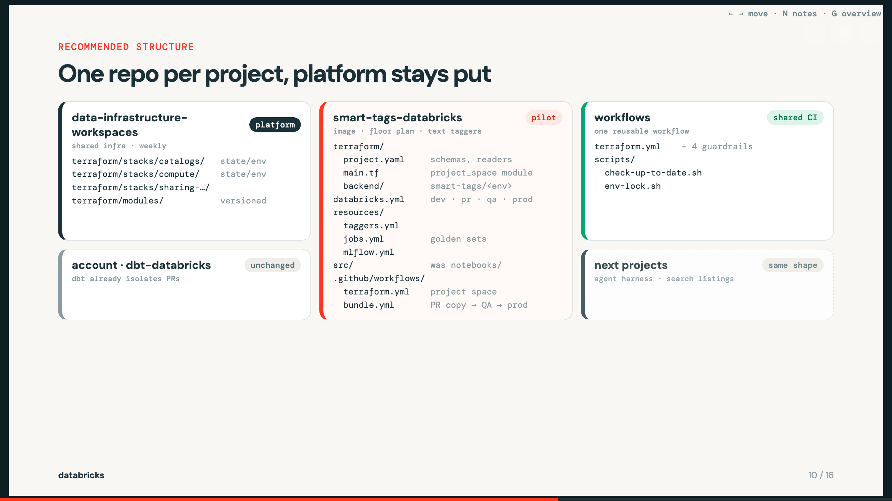
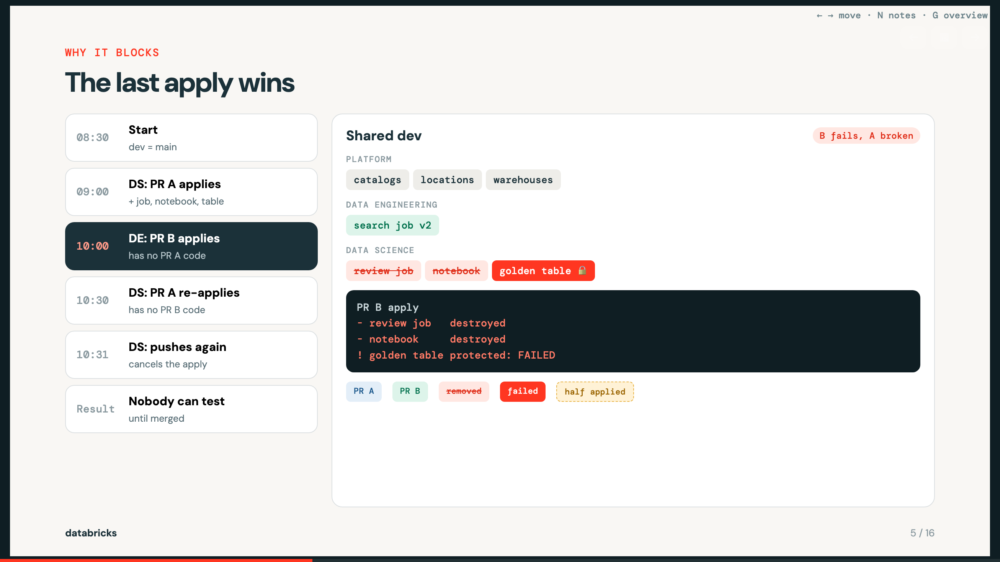
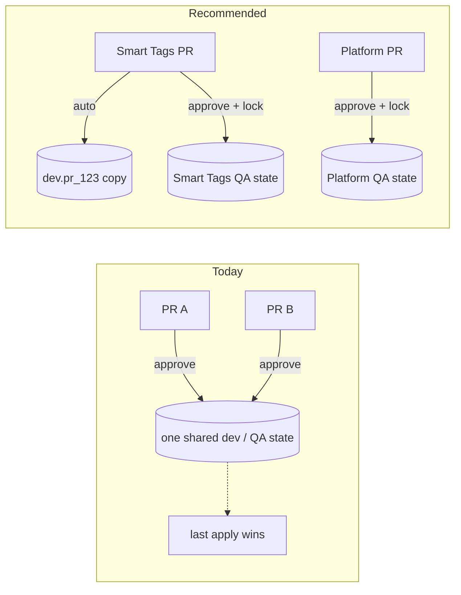
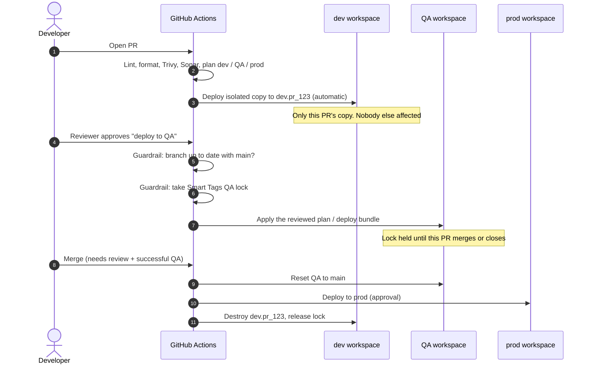
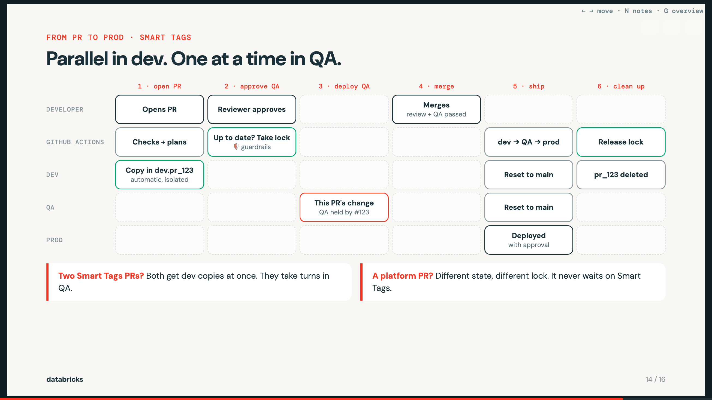
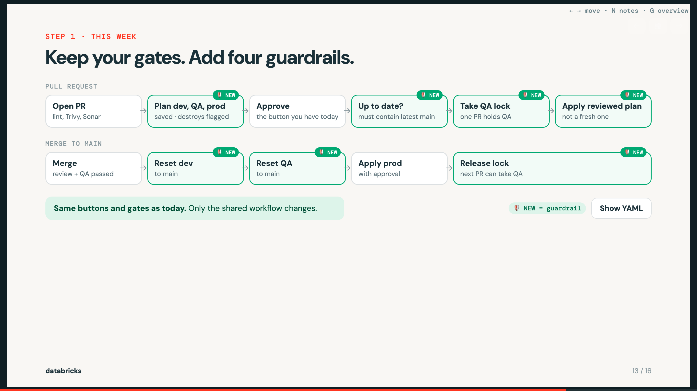

# Databricks Terraform + Asset Bundles: project-level separation

A worked example for Zoopla, following the architecture review on 19 November 2026. It shows how to keep today's review and approval flow while stopping pull requests from overwriting each other, starting with **Smart Tags** as the pilot project.

📄 **Slides:** [docs/Zoopla_Terraform_Review.pdf](docs/Zoopla_Terraform_Review.pdf)

> **Template only.** Hosts, IDs, buckets, groups and `<org>` are placeholders. Nothing here has been applied.

## What we agreed
- **Project-level Terraform state separation.** Each project gets its own space with its own state.
- **Smart Tags is the pilot.** Image, floor plan and text taggers are one project, in a dedicated repo.

## The idea in four lines
1. **Platform** (catalogs, warehouses, network) stays in `data-infrastructure-workspaces`, split into stacks with their own state.
2. **Each project** (Smart Tags first) gets its own repo: its own Terraform state for schemas and grants, its own Asset Bundle for jobs and notebooks, its own CI/CD.
3. **Keep today's flow** (plan on PR, approval buttons, QA before merge, prod from main) and add **four guardrails** so applies can't overwrite each other.
4. **Every project PR gets its own copy** of its jobs and tables in `dev.pr_<number>`, deleted when the PR closes.

## Recommended structure

```
data-infrastructure-account/        unchanged: identity, groups, metastore
data-infrastructure-workspaces/     PLATFORM: shared infrastructure only
  terraform/stacks/catalogs/          own state per env
  terraform/stacks/compute/           own state per env
  terraform/stacks/sharing-federation/
  terraform/modules/                  versioned, incl. project_space
workflows/                          shared reusable Terraform workflow + guardrail scripts
smart-tags-databricks/              PROJECT (pilot): everything Smart Tags owns
  terraform/project.yaml              schemas, readers, policy  → state smart-tags/<env>
  databricks.yml + resources/         image, floor plan, text taggers, golden sets, MLflow
  .github/workflows/                  its own CI/CD
<next-project>-databricks/          agent harness, search listings ... same shape
dbt-databricks/                     unchanged: already isolates PRs
```



In this repo each of those lives under [`repos/`](repos/). A project can also be a folder in a shared repo instead of its own repo: what matters is that it has **its own state**.

## Why PRs clash today



## Today vs recommended



## From PR to prod (Smart Tags)





## The four guardrails (shared workflow)



| # | Guardrail | Stops |
|---|---|---|
| 1 | Branch must be up to date with `main` before applying | An older branch undoing merged work |
| 2 | One PR holds an environment's lock (per project) until it merges or closes | PRs taking turns overwriting QA |
| 3 | Apply the exact saved plan that was reviewed | Applying something different from what was approved |
| 4 | Destroys flagged in the run summary | Deleting someone else's resources unnoticed |

Plus: on merge, **dev and QA are reset to `main`**, so shared environments always match what's merged. See [`repos/workflows/`](repos/workflows/).

## What's where in this repo

| Path | What |
|---|---|
| [`repos/workflows/`](repos/workflows/) | Shared reusable Terraform workflow with the guardrails, plus `check-up-to-date.sh` and `env-lock.sh` |
| [`repos/data-infrastructure-workspaces/`](repos/data-infrastructure-workspaces/) | Platform stacks, versioned modules (`project_space` is new), caller workflow |
| [`repos/smart-tags-databricks/`](repos/smart-tags-databricks/) | The pilot project repo: project space, bundle, CI/CD |
| [`migration/`](migration/) | Moving Smart Tags out of the workspaces state with no downtime (`removed` blocks + `bundle deployment bind`) |

## Steps

| Step | What | Effort |
|---|---|---|
| 1 | Add the four guardrails and the reset-to-main to the shared workflow | Days |
| 2 | Pilot: Smart Tags into its own repo (project space + bundle) | 2 to 3 weeks |
| 3 | Next projects one at a time (agent harness, search listings) | Weeks |
| 4 | Slim the platform: split stacks, move remaining grants to projects | Weeks |
| 5 | Tidy up: service principal OAuth instead of on-behalf-of tokens, one owner per grant, Predictive Optimization | Alongside |

## Useful reading

**Databricks**
- [CI/CD on Databricks](https://docs.databricks.com/aws/en/dev-tools/ci-cd/): overview and recommended workflows
- [Asset Bundles](https://docs.databricks.com/aws/en/dev-tools/bundles/) and [deployment modes](https://docs.databricks.com/aws/en/dev-tools/bundles/deployment-modes) (development vs production targets)
- [CI/CD with bundles](https://docs.databricks.com/aws/en/dev-tools/bundles/ci-cd) and [GitHub Actions](https://docs.databricks.com/aws/en/dev-tools/ci-cd/github)
- [Migrate existing resources into a bundle](https://docs.databricks.com/aws/en/dev-tools/bundles/migrate-resources) and [`bundle deployment bind`](https://docs.databricks.com/aws/en/dev-tools/cli/bundle-commands)
- [Workload identity federation (OIDC)](https://docs.databricks.com/aws/en/dev-tools/auth/oauth-federation): CI without long-lived tokens
- [Unity Catalog best practices](https://docs.databricks.com/aws/en/data-governance/unity-catalog/best-practices) and [workspace-catalog binding](https://docs.databricks.com/aws/en/catalogs/binding)
- [Predictive Optimization](https://docs.databricks.com/aws/en/optimizations/predictive-optimization): automatic OPTIMIZE and VACUUM
- [Databricks Terraform provider](https://docs.databricks.com/aws/en/dev-tools/terraform/) and the [Unity Catalog Terraform guide](https://registry.terraform.io/providers/databricks/databricks/latest/docs/guides/unity-catalog)
- [MLOps Stacks](https://docs.databricks.com/aws/en/machine-learning/mlops/mlops-stacks): Databricks' reference project layout for ML projects with dev, staging and prod

**Examples**
- [databricks/bundle-examples](https://github.com/databricks/bundle-examples)
- [databricks/terraform-databricks-examples](https://github.com/databricks/terraform-databricks-examples)
- [databricks/mlops-stacks](https://github.com/databricks/mlops-stacks)

**Terraform and GitHub**
- [Terraform `removed` blocks](https://developer.hashicorp.com/terraform/language/resources/syntax): forget resources without destroying them
- [GitHub Environments](https://docs.github.com/en/actions/managing-workflow-runs-and-deployments/managing-deployments/managing-environments-for-deployment): approvals, prevent self-review
- [GitHub merge queue](https://docs.github.com/en/repositories/configuring-branches-and-merges-in-your-repository/configuring-pull-request-merges/managing-a-merge-queue)

## Notes
- Workflows under `repos/*/.github/` don't run here. Copy them into the real repos.
- `terraform validate` passes for every Terraform folder (Terraform 1.11, Databricks provider 1.113+). Not applied to a live workspace.
